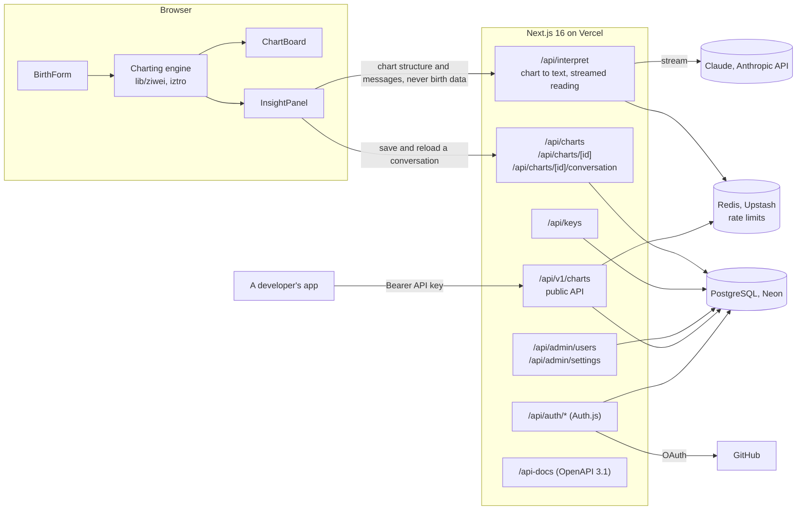
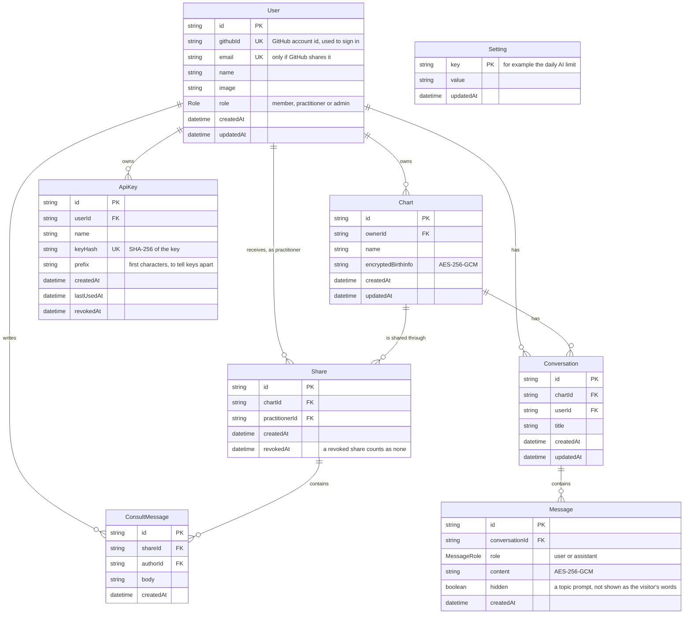

# Architecture

Ziwei Natal Chart is one Next.js 16 app on Vercel. The chart is built in the browser; the server handles
accounts, saved data, AI readings and the public API. The diagrams below are Mermaid, so GitHub
renders them, and they change in the same pull request as the code they describe.

## System



### What happens on the main paths

1. **Chart and reading.** The visitor fills in the birth form, and `generateChart()` builds the chart in the browser. The reading panel posts the chart and the messages to `/api/interpret`.
   - The server turns the chart into text with a serializer in `lib/ai/`. It sends Claude the twelve palaces and the decade ranges, never the birth date, hour or gender.
   - The reading streams back as `data: {"delta":{"text":"…"}}` lines, ending with `data: [DONE]`.
2. **Saved charts.** A signed-in member saves a chart through `/api/charts`; the birth data is encrypted before it is stored. On a saved chart, each finished exchange of the reading is appended to `/api/charts/[id]/conversation`. Reopening the chart at `/chart?id=…` shows that conversation again.
3. **Public API.** A developer creates a key on `/settings` and calls `POST /api/v1/charts` with `Authorization: Bearer <key>`. The chart comes back as JSON.

### Security and limits

| What | How |
|---|---|
| Sign-in | Auth.js v5 with GitHub OAuth and JWT sessions. Every protected route checks the session first, then the role or chart ownership. |
| Roles | `member`, `practitioner` and `admin` (`lib/auth/`). A user only sees their own charts and charts shared with them. |
| Birth data and conversations | Encrypted at rest with AES-256-GCM (`lib/crypto.ts`, key in `DATA_ENCRYPTION_KEY`). |
| API keys | 256-bit random tokens, stored as SHA-256 hashes; the plain key is shown once. |
| AI rate limit | 20 requests an hour per user and 100 per IP on `/api/interpret`, plus a daily limit per user that admins set (default 50). |
| Public API rate limit | 60 requests a minute per API key on `/api/v1/*`. |
| Rate-limit store | Redis when `REDIS_URL` is set, so every serverless instance shares one count; memory otherwise, for local development. If Redis is down, requests go through. |
| Input | Every request body and environment variable is parsed with zod. A 400 means a bad body, 401 no session, 403 not allowed, 404 not yours. |

## Database

PostgreSQL on Neon, through Prisma (`prisma/schema.prisma`). Production uses Neon's `main` branch, each Vercel preview gets its own Neon branch, and migrations run in the build with `prisma migrate deploy`.



### What deleting does

- **Deleting a chart** deletes its shares, conversations and messages.
- **Deleting a user** deletes their charts, conversations and API keys. It is refused while the user is a practitioner on a share or the author of a consultation message, so consultation history never disappears quietly. There is no user deletion in this release.

## Code map

```
app/                 Pages and API routes (app/api/<name>/route.ts)
components/          React components, one per file
lib/ziwei/           The charting engine: pure functions, runs in the browser
lib/ai/              Prompt building, chart to text, the Anthropic client (server only)
lib/auth/            Session, role and ownership checks
lib/charts/          Saved charts; lib/conversations/ for their conversations
lib/api/             API keys and the public API
lib/rate-limit/      Fixed-window limits on Redis or memory
lib/crypto.ts        AES-256-GCM for data at rest
lib/i18n/, messages/ Chinese and English (next-intl); Chinese is the source of truth
prisma/              Schema and migrations
tests/, e2e/         Vitest unit and integration tests, Playwright E2E
```
